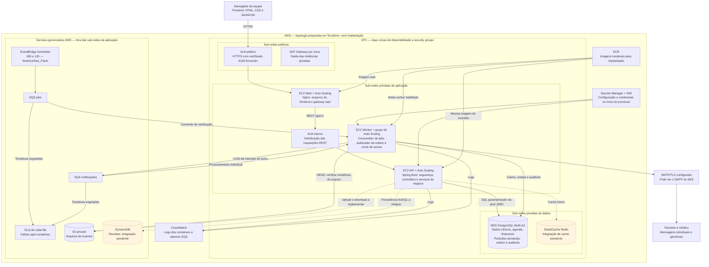
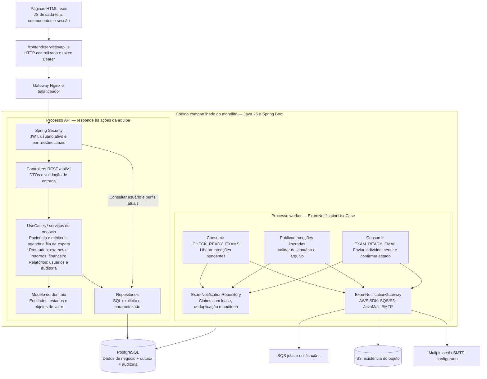

# Arquitetura de sistemas — Clínica Hans

Referência: código, Docker Compose, Terraform e decisões do projeto em 28/10/2026. API e worker compartilham o monólito Java/Spring Boot e a mesma imagem Docker; executam em processos separados. Os serviços de negócio são componentes internos desse monólito.

Formato editável: [draw.io com cinco abas](system-architecture.drawio). Para consultar nomes, tipos, imagens, portas, volumes e recursos AWS emulados: [inventário do ambiente local](localstack-inventory.md).

O draw.io usa [ícones AWS nativos com referência no AWS Shape Pack do Miro](aws-icons-reference.md), preservando os nomes dos containers e recursos locais. A aba AWS prevista apresenta a correspondência desses elementos com a implantação futura.

O ambiente local foi validado com oito containers. A topologia AWS abaixo está descrita em Terraform e ainda não foi implantada. Linhas tracejadas identificam integrações de aplicação pendentes; linhas contínuas mostram os caminhos implementados em software ou definidos na infraestrutura alvo. E-mails externos permanecem desabilitados na configuração local.

## 1. Infraestrutura e aplicações



As setas representam chamadas lógicas, sem repetir todos os saltos de rede. As EC2 privadas usam os NAT Gateways para acesso de saída a serviços AWS/SMTP e download de imagens/pacotes. A entrada pública passa pelo Internet Gateway e ALB; bancos e EC2 não recebem acesso público direto. Administração prevista por SSM, sem SSH público. DNS do domínio e certificado ACM precisam estar configurados para a implantação.

O frontend executa JavaScript no navegador. As EC2 web servem seus arquivos e encaminham chamadas REST pelo gateway Nginx. No desenho atual, o gateway limita requisições e adiciona o identificador de correlação; JWT e permissões são validados na API Spring Security.

### Correspondência entre local e AWS

| Papel | Local validado | AWS preparada |
|---|---|---|
| Frontend e gateway | Container `frontend`, porta 8090 | EC2 Web, Nginx e ALB público |
| Balanceador da API | Container `backend-lb` | ALB interno |
| API | Container `backend` | EC2 API em Auto Scaling |
| Worker | Container `notification-worker` | EC2 Worker, imagem do mesmo monólito |
| Banco transacional | Container `db`, volume persistente | RDS PostgreSQL Multi-AZ |
| Cache | Container `redis`, ainda não consumido | ElastiCache, integração pendente |
| SQS, Scheduler, S3 e DynamoDB | Emulação no container `localstack` | Serviços AWS correspondentes |
| E-mail | Captura SMTP no container `mailpit`, painel 8025 | SMTP externo com STARTTLS e habilitação explícita |

São oito containers locais: frontend, backend-lb, backend, notification-worker, db, redis, localstack e mailpit. LocalStack emula as APIs AWS utilizadas; os containers executam frontend e backend. EC2, RDS e Auto Scaling reais pertencem à implantação AWS futura.

## 2. Organização do software



Os componentes internos dividem responsabilidades: controllers recebem o contrato HTTP, UseCases aplicam regras e autorização contextual, o modelo representa o domínio e repositories acessam o banco. A aplicação usa JDBC/JdbcTemplate com pool de conexões e não usa JPA/Hibernate. API e worker usam o mesmo código; o modo worker é habilitado por configuração apenas no processo consumidor.

## 3. Ordem para colocar a aplicação em funcionamento

1. **Preparar o ambiente.** Iniciar Docker Desktop em modo Linux. Executar `scripts/localstack.ps1 init` quando não houver configuração local; preencher o token LocalStack e preservar as credenciais/porta do PostgreSQL existente. O arquivo `.env.localstack` fica fora do Git.
2. **Construir as imagens e iniciar a base.** `scripts/localstack.ps1 start-all` constrói frontend e monólito e inicia PostgreSQL, Redis, LocalStack e Mailpit. LocalStack provisiona bucket, tabela DynamoDB, filas, DLQs, permissões IAM/STS e agendamento.
3. **Inicializar a API.** Com o PostgreSQL saudável, o backend aplica as migrations pendentes, provisiona partições futuras e cria o administrador de bootstrap somente se ele ainda não existir. A senha de usuário existente é preservada. Só depois a API fica pronta para tráfego.
4. **Liberar o acesso e iniciar o worker.** Balanceador/frontend aguardam a API saudável conforme suas dependências. O worker aguarda API e LocalStack saudáveis, usa a mesma imagem e começa a consultar as filas. Não manter API e worker iniciando migrations novas ao mesmo tempo: em atualização, parar o worker e migrar primeiro com uma API.
5. **Validar.** `scripts/localstack.ps1 verify-app` testa frontend, login e API protegida. `scripts/localstack.ps1 verify` testa storage/filas e entrega de um agendamento temporário. Aplicação: `http://localhost:8090/login/login.html`; captura de e-mails: `http://localhost:8025`.

Na AWS, primeiro revisar/aplicar rede e dados, publicar imagens ECR e configurar secrets, usuário SQL, DNS e certificado. Inicialmente a API permanece com capacidade zero; depois usa uma instância para migrations e somente então pode crescer. O Terraform configura duas EC2 web como base, API até seis instâncias e grupo de workers de zero a seis; a política automática de CPU está preparada para web/API, enquanto o dimensionamento dos workers depende da configuração e de medições de backlog. Essa sequência está detalhada em [infra/README.md](../../infra/README.md).

## 4. Caminho de uma operação comum

1. A pessoa abre uma página. O gateway entrega HTML, CSS e JavaScript; o navegador executa a interface.
2. No login, `services/api.js` chama a API pelo mesmo domínio. O backend verifica credenciais e devolve um JWT; o frontend mantém a sessão no `sessionStorage`.
3. Ao cadastrar paciente, agendar consulta ou abrir prontuário, o frontend envia JSON e o token Bearer para `/api/v1/**`.
4. Gateway e balanceador encaminham a requisição para uma instância da API. A API verifica assinatura/expiração do token, usuário ativo, perfis atuais e as permissões do caso de uso.
5. O controller valida o contrato e chama o UseCase. O UseCase aplica as regras: por exemplo, acesso ao atendimento correto e proteção contra conflito de agenda.
6. O repository executa SQL parametrizado pelo pool JDBC. Transações e constraints preservam a integridade; eventos relevantes registram auditoria no banco.
7. A API devolve JSON e o identificador de correlação pelo mesmo caminho. A tela apresenta sucesso, erro ou resultado vazio. Erros de notificação não precisam interromper agenda ou atendimento.

Consultas e alterações operacionais seguem esse caminho direto. As filas são usadas para trabalho em segundo plano.

## 5. Caminho do resultado de exame e dos avisos

```mermaid
sequenceDiagram
    autonumber
    participant UI as Tela de resultado
    participant API as API / ContinuityUseCase
    participant DB as PostgreSQL / outbox
    participant CLOCK as Scheduler
    participant JQ as SQS jobs
    participant W as Worker do monólito
    participant S3 as S3 privado
    participant NQ as SQS notificações
    participant SMTP as Mailpit / SMTP

    UI->>API: Registrar storageKey e mimeType, com JWT
    API->>API: Validar contrato, perfil e acesso ao atendimento
    API->>DB: BEGIN: resultado + status + duas intenções WAITING
    DB-->>API: COMMIT
    API-->>UI: 200 OK: resultado registrado
    Note over UI,S3: Upload pela tela ainda pendente; arquivo precisa existir no bucket
    Note over CLOCK,DB: As intenções aguardam o job de 00h ou 12h de São Paulo
    CLOCK->>JQ: CHECK_READY_EXAMS, versão 1
    W->>JQ: Receber comando
    W->>DB: Liberar intenções elegíveis para READY
    W->>JQ: Confirmar processamento do comando
    loop Paciente e médico, independentemente
        W->>DB: Obter intenção com lease e consultar destinatário atual
        W->>S3: HEAD do objeto do exame
        alt Destinatário inválido, inativo ou arquivo ausente
            W->>DB: BLOCKED e código técnico; reavaliar no próximo job
        else Condições válidas
            W->>NQ: EXAM_READY_EMAIL + UUID da intenção
            W->>DB: Registrar publicação
            W->>NQ: Receber mensagem de aviso
            W->>DB: Claim exclusivo e consulta do estado atual
            W->>S3: Revalidar existência do objeto
            W->>SMTP: Mensagem individual, genérica, sem anexo
            alt SMTP aceitou e confirmação no banco teve sucesso
                W->>DB: Transação: SENT + auditoria
                W->>NQ: Excluir mensagem processada
            else Falha de envio
                W->>DB: Registrar falha e tentativa
                Note over W,NQ: Sem confirmação, mensagem pode voltar; falhas persistentes vão à DLQ
            end
        end
    end
```

O médico é o responsável pelo atendimento que originou a solicitação. Cada destinatário possui uma intenção própria, evitando que um contato inválido impeça o outro aviso. O envio exige resultado recebido/revisado, destinatário ativo com endereço válido e arquivo presente no S3. Resultados anteriores à migração não geram avisos retroativos automaticamente.

O e-mail do médico aponta ao sistema autenticado. Como o portal de pacientes ainda não existe, o aviso ao paciente orienta os canais habituais da clínica. Nenhum aviso contém nome do exame, resultado ou anexo. `SENT` significa aceitação pelo SMTP; falha entre essa aceitação e a gravação no banco ainda pode causar duplicidade. Detalhes: [contrato dos avisos](../specs/exam-ready-notifications.md).

## 6. Como a estrutura acompanha o crescimento

| Pressão de carga | Resposta do desenho | Limite a observar |
|---|---|---|
| Muitas requisições simultâneas | Balanceador e réplicas da API | Pool total de conexões, CPU e capacidade do banco |
| Picos de tarefas de aviso | SQS acumula trabalho; workers podem crescer separadamente | Idade da fila, tempo de processamento e limites SMTP |
| Histórico crescente | Partições semanais, índices, paginação e locators por UUID | Consultas precisam usar filtros adequados; partição não distribui escrita entre servidores |
| Arquivos grandes | Objetos no S3; metadados no PostgreSQL | Upload/download e autorização ainda precisam de integração com a tela |
| Leituras repetidas | Redis previsto | Integração de cache/invalidação ainda pendente |
| Continuidade do banco em AWS | RDS Multi-AZ, backups e proteção de exclusão | Standby não é réplica de leitura; restauração e carga ainda precisam ser validadas |

O volume alvo de mais de um milhão de atendimentos mensais continua sendo uma meta a comprovar por teste de carga. A existência de filas, réplicas e partições não comprova essa capacidade por si só.

## 7. Estado das integrações

- **Implementado e validado localmente:** frontend, gateway/balanceador, API, PostgreSQL particionado, outbox, consumo/publicação SQS, verificação S3, job de 12 horas e captura de e-mails no Mailpit.
- **Preparado e ainda sem integração funcional:** Redis como cache e DynamoDB para receitas. Prescrições/itens existentes continuam no modelo PostgreSQL; emissão e assinatura não fazem parte desta etapa.
- **Pendente:** upload/download de exames pela tela, portal de pacientes, SMTP externo de produção, implantação AWS, testes de carga e restauração.

Fontes do repositório: [arquitetura](../memory-bank/architecture.md), [decisões](../memory-bank/decisions.md), [infraestrutura](../../infra/README.md), [Compose da API](../../docker-compose.application.yml), [Compose do worker](../../docker-compose.notifications.yml) e [Terraform](../../infra/aws/compute.tf).
