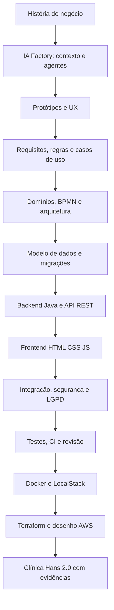
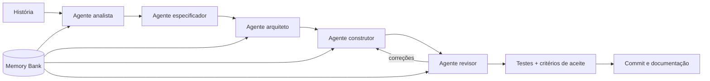
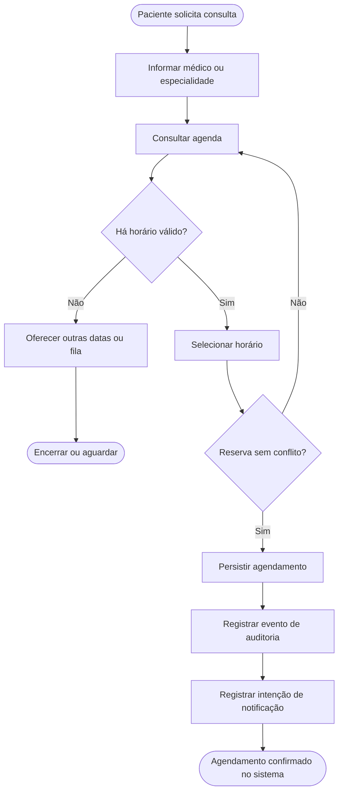
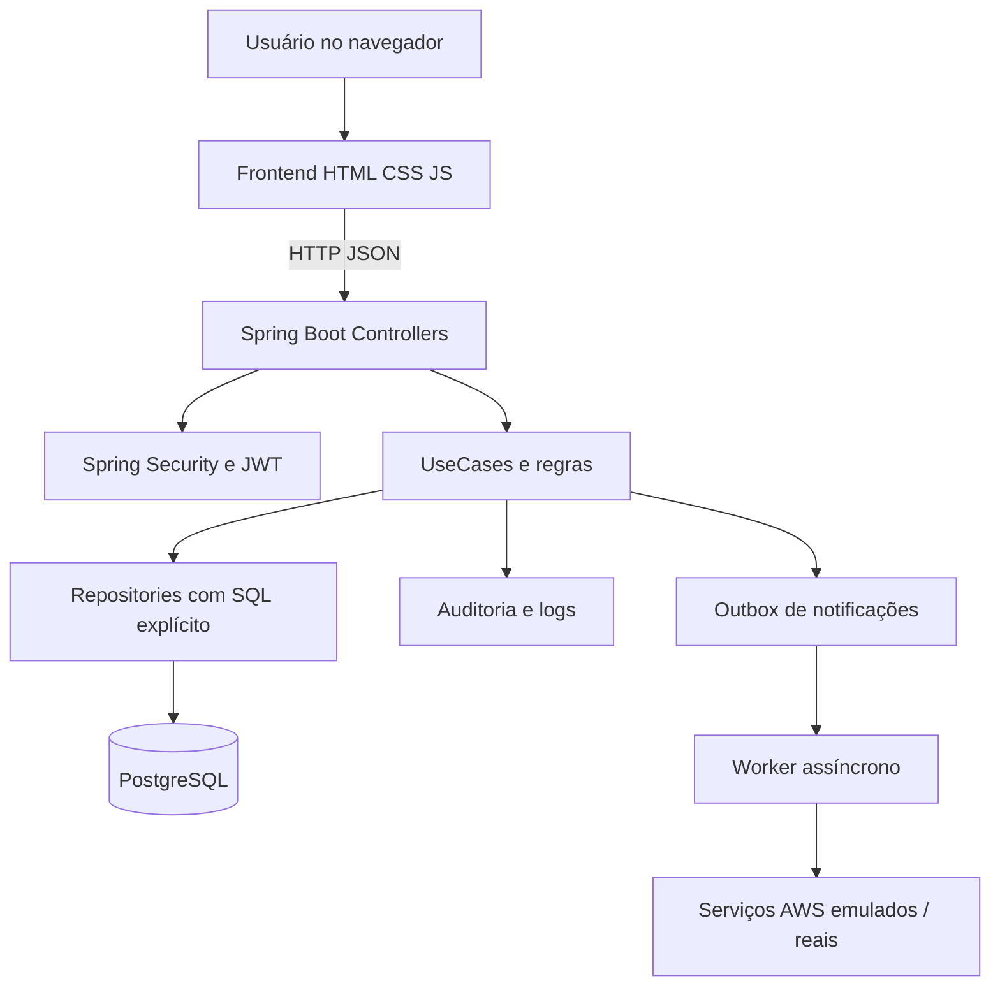
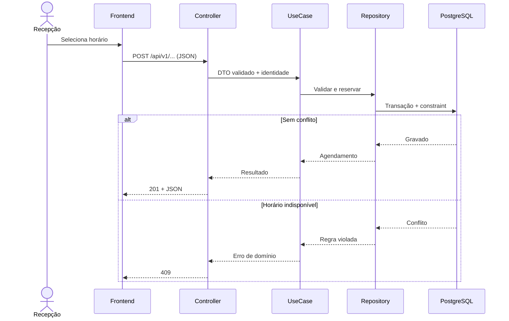
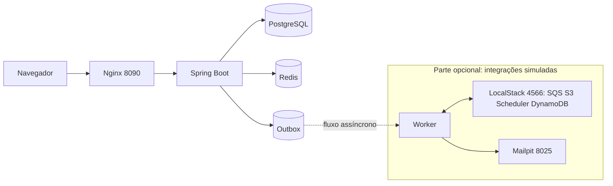
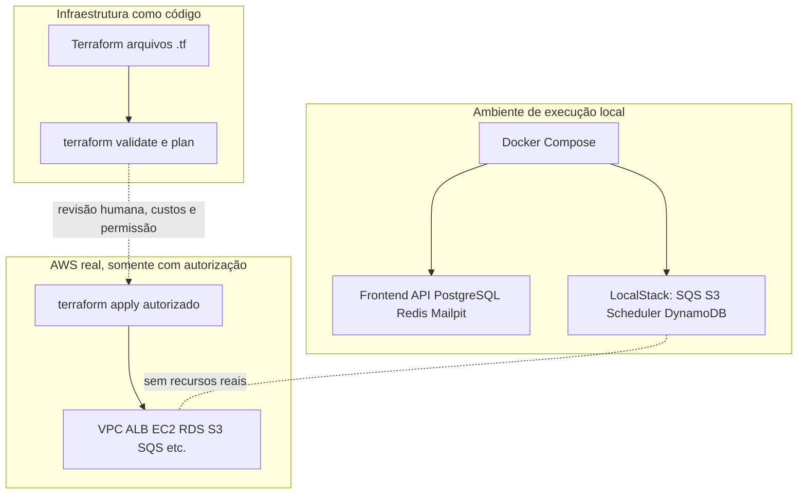

# Roadmap expandido de conhecimento — IA Factory à Clínica Hans 2.0

**Público-alvo:** alunos de desenvolvimento de software que partirão dos fundamentos até uma aplicação completa.  
**Carga sugerida:** 24 semanas, 144 horas (6 h/semana). A duração é proposta didática, não requisito do projeto.  
**Referência prática:** https://github.com/itodoconhecer-cmyk/clinicahans  
**Fonte inicial:** arquivo `IA_Factory-main.zip` fornecido pelo docente.  
**Regra essencial:** IA auxilia a engenharia, mas o estudante deve compreender, defender e verificar o código.

## 0. Como utilizar este guia

Cada módulo contém objetivos, conceitos, caminho de estudo **dentro do repositório**, fonte externa, laboratório, entrega e evidência de aprendizagem. O professor pode trabalhar com commits e branches históricos para mostrar a evolução real. A estrutura de pastas muda conforme o commit; links a `main` representam a versão consultada em 28/10/2026.

**Critério de conclusão de cada etapa:** código funcional + teste + explicação da decisão + documentação + commit rastreável. Não confundir pasta existente, código implementado e comportamento efetivamente validado.

### Diagrama 1 — Evolução pedagógica



## 1. Cronograma expandido

| Semanas | Unidade | Entrega comprovável |
|---|---|---|
| 1–2 | Fundamentos web, algoritmos, terminal e Git | Repositório, miniaplicação e histórico de commits |
| 3–4 | JavaScript, HTTP, HTML e CSS | Interface responsiva com chamada `fetch` |
| 5–6 | IA Factory, engenharia de contexto e memória | Máquina configurada para história inédita |
| 7–8 | Requisitos e modelagem de negócio | Backlog, regras, casos de uso e BPMN |
| 9–10 | UX, protótipos, arquitetura e diagramas | Telas navegáveis, desenhos e ADRs |
| 11–12 | Modelagem relacional e SQL | Schema PostgreSQL, migrations e consultas |
| 13–15 | Java, orientação a objetos e Spring Boot | API REST, endpoints e regras de negócio |
| 16–17 | Integração frontend/backend | Cadastro, agenda e fluxo completo em navegador |
| 18–19 | Segurança, LGPD e observabilidade | RBAC, auditoria, logs e controles testados |
| 20–21 | Testes, revisão e GitHub Actions | Unitários, integração, E2E e pipeline verde |
| 22 | Docker e Docker Compose | Ambiente local reproduzível |
| 23 | LocalStack e mensageria AWS simulada | Evidência de fluxo SQS + worker + e-mail |
| 24 | Terraform, apresentação e superação do projeto | Plano de infraestrutura e demo avaliada |

## 2. Unidade 1 — Fundamentos web, Git e colaboração (semanas 1–2)

**Conhecimentos:** algoritmos, entrada/saída, condições, laços, funções, CLI, arquivos, internet e navegador, cliente-servidor, HTTP, JSON, Git (`init`, `add`, `commit`, `branch`, `merge`, `log`), pull requests e revisão.

**Dentro da Clínica Hans:** `.gitignore`, `.editorconfig`, `README.md`, `.github/workflows/`, histórico de PRs e commits; compare a correção de estrutura no commit `e32aeed82357b2058ac3a0ab73b55875d5591656`.

**Na internet:** [Git Book](https://git-scm.com/book/pt-br/v2), [GitHub Docs](https://docs.github.com/pt), [MDN HTTP](https://developer.mozilla.org/pt-BR/docs/Web/HTTP), [MDN JavaScript](https://developer.mozilla.org/pt-BR/docs/Web/JavaScript).

**Laboratório:** fazer clone, criar branch `aluno/seu-nome`, corrigir uma página pequena, abrir PR com evidência antes/depois. **Entrega:** PR revisado e resumo de `git log`.

## 3. Unidade 2 — HTML, CSS, JavaScript e consumo de APIs (semanas 3–4)

**Conhecimentos:** HTML semântico, formulários, acessibilidade, box model, Flexbox, Grid, responsividade, DOM, eventos, módulos ES, promises, `async/await`, Fetch API, JSON e tratamento de falhas HTTP.

**No código:** `frontend/login/`, `frontend/cadastro-medico/`, `frontend/novo-agendamento/`, `frontend/services/`, `frontend/config.js`, `frontend/verify-architecture.mjs`. O padrão final é uma pasta por tela, com HTML/CSS/JS separados — **não React**.

**Na internet:** [MDN HTML](https://developer.mozilla.org/pt-BR/docs/Web/HTML), [MDN CSS](https://developer.mozilla.org/pt-BR/docs/Web/CSS), [Fetch API](https://developer.mozilla.org/en-US/docs/Web/API/Fetch_API), [WAI WCAG](https://www.w3.org/WAI/standards-guidelines/wcag/).

**Laboratório:** tela de médicos com listagem, filtro e mensagens de erro; simular falha 401, 403 e 500. **Entrega:** tela responsiva, acessível e com requisições inspecionadas no DevTools.

## 4. Unidade 3 — IA Factory e engenharia de contexto (semanas 5–6)

**Conhecimentos:** diferença entre prompt isolado e contexto persistente; agentes por papel; instruções globais e por camada; skill reutilizável; memória de decisões; padrões; versionamento de prompts; verificação de artefatos gerados e limites de IA.

**Na IA Factory original e no repo:** `AGENTS.md`, `.github/copilot-instructions.md`, `.github/agents/{analyst,architect,specifier,builder,reviewer}.agent.md`, `.github/instructions/`, `.github/skills/create-endpoint/`, `.github/skills/generate-crud/`, `docs/memory-bank/{product,business-rules,architecture,decisions,current-state}.md`, `.github/prompts/01-...` até `05-...`, `input/application-story.md`.

**Na internet:** [GitHub Copilot docs](https://docs.github.com/en/copilot), [Prompt engineering — OpenAI](https://platform.openai.com/docs/guides/prompt-engineering), [GitHub custom instructions](https://docs.github.com/en/copilot/how-tos/configure-custom-instructions).

**Laboratório:** aluno escreve uma nova história e define critérios de qualidade da fábrica; compare saídas com e sem memória. **Entrega:** regras da IA documentadas e uma análise crítica de código gerado.

### Diagrama 2 — Responsabilidades da fábrica



## 5. Unidade 4 — Requisitos, domínios e processos (semanas 7–8)

**Conhecimentos:** história de usuário, caso de uso, RF/RNF, invariantes, domínio, estados, exceções, fluxos alternativos, requisitos de segurança e rastreabilidade. BPMN 2.0: eventos, atividades, gateways, raias, exceções.

**No código e docs:** `input/application-story.md`, `docs/specs/functional-requirements.md`, `docs/specs/use-cases.md`, `docs/specs/business-rules.md`, `docs/specs/domains.md`, `docs/specs/traceability-matrix.md`, `docs/diagrams/process.bpmn`, `docs/diagrams/process.drawio`.

**Na internet:** [OMG BPMN](https://www.omg.org/spec/BPMN/2.0.2), [Camunda BPMN Reference](https://docs.camunda.io/docs/components/modeler/bpmn/), [draw.io](https://www.drawio.com/), [C4 model](https://c4model.com/).

**Laboratório:** especificar criação de agendamento incluindo horários disponíveis, conflito, médico desativado e cancelamento. **Entrega:** BPMN e casos de uso com cenários negativos.

### Diagrama 3 — Exemplo de processo para o aluno detalhar



O diagrama é didático e não substitui o BPMN completo existente.

## 6. Unidade 5 — UX, arquitetura e protótipos (semanas 9–10)

**Conhecimentos:** jornadas, fluxos de interface, consistência visual, acessibilidade, prototipação, arquitetura em camadas, componentes, decisões arquiteturais (ADRs), modelo C4, diagramas de sequência e estados.

**No código:** `prototypes/`, `frontend/`, `docs/specs/ui-screen-inventory.md`, `docs/architecture/solution-overview.md`, `docs/architecture/engineering-standards.md`, `docs/diagrams/system-architecture.drawio`, `docs/diagrams/context-map.mmd`, `docs/diagrams/domain-model.mmd`.

**Na internet:** [Nielsen Norman Group](https://www.nngroup.com/articles/ten-usability-heuristics/), [Mermaid](https://mermaid.js.org/), [draw.io docs](https://www.drawio.com/doc/), [C4 model](https://c4model.com/).

**Laboratório:** mapear telas de médicos, pacientes, agenda e atendimento; prototipar fluxo completo e rever permissões por perfil. **Entrega:** protótipo navegável, decisão arquitetural registrada e inventário rastreável.

### Diagrama 4 — Arquitetura lógica simplificada



## 7. Unidade 6 — Banco de dados e SQL explícito (semanas 11–12)

**Conhecimentos:** entidades/relacionamentos, normalização, PK/FK, índices, constraints, transações ACID, isolamento, bloqueios, conflitos de agenda, migrações, particionamento e desempenho. Diferenciar SQL explícito/JDBC de ORM/JPA.

**No código:** `backend/src/main/resources/`, `backend/src/main/java/` (procurar `repository`), `backend/pom.xml`, `docs/specs/domain-model.md`, `docs/diagrams/domain-model.mmd`. Localize as migrations de banco e as constraints antes de alterar schema.

**Na internet:** [PostgreSQL docs](https://www.postgresql.org/docs/16/), [Spring JDBC](https://docs.spring.io/spring-framework/reference/data-access/jdbc.html), [Flyway docs](https://documentation.red-gate.com/fd/).

**Laboratório:** reproduzir dois agendamentos concorrentes para mesmo horário e impedir duplicidade por regra transacional. **Entrega:** schema, SQL parametrizado, migration reversível quando aplicável e teste integrado.

## 8. Unidade 7 — Backend Java + Spring Boot (semanas 13–15)

**Conhecimentos:** Java, orientação a objetos, encapsulamento, interfaces, collections, exceptions, streams quando apropriado, Maven, Spring Boot, MVC, DI, validação, DTO, mapper, command, use case, repository, API REST, contratos e OpenAPI.

**No código:** `backend/pom.xml`, `backend/src/main/java/` e pacotes `controller`, `DTO`, `UseCase`, `command`, `mapper`, `model`, `repository`, `utilities`; `backend/verify-architecture.sh`; commit de refatoração `2ea37d0c488e28e9748f69f280f76216ebe5601b`.

**Na internet:** [Java Learn](https://dev.java/learn/), [Spring Boot](https://docs.spring.io/spring-boot/reference/), [Spring MVC](https://docs.spring.io/spring-framework/reference/web/webmvc.html), [OpenAPI](https://spec.openapis.org/oas/latest.html).

**Laboratório:** API para médicos, pacientes e agenda com erro padronizado, autorização e testes. **Entrega:** documentação de endpoints, payloads JSON e execução contra PostgreSQL real.

### Diagrama 5 — Sequência de agendamento



## 9. Unidade 8 — Integração multipágina (semanas 16–17)

**Conhecimentos:** contrato de API, DTO no navegador, base URL, CORS quando necessário, tratamento de sessão, navegação, filtros, carregamento, latência, acessibilidade e testes em DevTools.

**No código:** `frontend/services/api.js`, `frontend/agenda/`, `frontend/novo-agendamento/`, `frontend/cadastro-paciente/`, `frontend/cadastro-medico/`, `frontend/relatorios/`, `frontend/verify-architecture.mjs`.

**Na internet:** [Fetch API](https://developer.mozilla.org/en-US/docs/Web/API/Fetch_API), [HTTP status](https://developer.mozilla.org/en-US/docs/Web/HTTP/Status), [OWASP API Top 10](https://owasp.org/API-Security/editions/2023/en/0x11-t10/).

**Laboratório:** conectar cadastro + listagem + edição + agendamento e verificar todos os status HTTP. **Entrega:** fluxo completo com vídeo curto ou evidência E2E.

## 10. Unidade 9 — Segurança, LGPD e auditoria (semanas 18–19)

**Conhecimentos:** autenticação vs autorização, JWT, bcrypt/armazenamento de credenciais, RBAC, menor privilégio, escopo médico, proteção de dados de saúde, minimização em logs, correlation ID, trilhas auditáveis e sessões expiradas.

**No código:** `docs/architecture/security.md`, `docs/architecture/security-baseline.md`, `docs/architecture/observability.md`, `frontend/login/`, `frontend/auditoria/`, `frontend/logs-publicos/`, `backend/src/main/java/` (pesquisar filtros de JWT, interceptors e políticas), commit `6d1f2f6287d257509a1d736b0ab6faa5503efd37`.

**Na internet:** [LGPD — Lei 13.709/2018](https://www.planalto.gov.br/ccivil_03/_ato2015-2018/2018/lei/l13709.htm), [OWASP ASVS](https://owasp.org/www-project-application-security-verification-standard/), [Spring Security](https://docs.spring.io/spring-security/reference/).

**Laboratório:** testar que recepcionista não abre informações clínicas e que médico A não modifica atendimento de B. **Entrega:** matriz de autorização com evidências de testes positivos/negativos.

## 11. Unidade 10 — Qualidade e automação (semanas 20–21)

**Conhecimentos:** pirâmide de testes, unitários, integração, E2E, banco real no CI, mocks com moderação, Playwright, análise estática, regressão, revisão por pares, CI com GitHub Actions.

**No código:** `.github/workflows/backend-ci.yml`, `.github/workflows/frontend-ci.yml`, `.github/workflows/scheduling-e2e.yml`, `frontend/verify-architecture.mjs`, `backend/verify-architecture.sh`, `tests/`, `docs/specs/traceability-matrix.md`.

**Na internet:** [GitHub Actions](https://docs.github.com/en/actions), [JUnit 5](https://junit.org/junit5/docs/current/user-guide/), [Playwright](https://playwright.dev/docs/intro), [Testing Spring Boot](https://docs.spring.io/spring-boot/reference/testing/).

**Laboratório:** criar bug intencional e comprovar falha do pipeline antes da correção. **Entrega:** PR bloqueado por teste e PR corrigido com evidência verde.

## 12. Unidade 11 — Docker e infraestrutura local (semana 22)

**Conhecimentos:** imagem vs container, Dockerfile, volumes, rede, portas, healthchecks, Compose, configuração por ambiente, secrets, logs e organização de serviços.

**No código:** `docker-compose.yml`, `docker-compose.application.yml`, `docker-compose.notifications.yml`, `backend/Dockerfile`, `infra/containers/`, `tools/docker-dashboard/`, `scripts/localstack.ps1`, `infra/README.md`.

**Na internet:** [Docker Get Started](https://docs.docker.com/get-started/), [Docker Compose](https://docs.docker.com/compose/), [Docker Networking](https://docs.docker.com/engine/network/).

**Laboratório:** subir PostgreSQL + API + Nginx, verificar login e analisar rede e logs sem expor credenciais. **Entrega:** guia de reprodução a partir de máquina limpa.

### Diagrama 6 — Ambiente local sem e com LocalStack



## 13. Unidade 12 — LocalStack: laboratório aprofundado (semana 23)

### 13.1. O que cada ferramenta realmente faz

- **Docker:** executa processos em containers; não é AWS.
- **Docker Compose:** configura e sobe vários containers como uma aplicação.
- **LocalStack:** emula APIs/serviços AWS **para desenvolvimento e testes**, sem criar recursos na conta AWS. A compatibilidade não substitui testes de cloud real.
- **Terraform:** descreve infraestrutura; `plan` calcula propostas, `apply` pode criar recursos reais e gerar custos.
- **Mailpit:** captura mensagens de e-mail do laboratório; não entrega e-mails para pacientes reais.

**Atenção ao licenciamento:** a distribuição LocalStack de 2026 exige conta/token de autenticação para a imagem corrente e os recursos disponíveis variam de acordo com a licença. Cada aluno deve usar credenciais próprias; nunca versioná-las.

### 13.2. Mapa de serviços e repositório

| Componente | Papel no exercício | Arquivo de referência | Documentação oficial |
|---|---|---|---|
| LocalStack gateway | Endpoint local para SDK AWS | `docker-compose.localstack.yml`, `infra/localstack/README.md` | https://docs.localstack.cloud/aws/getting-started/ |
| SQS | Filas de jobs e notificações | `docker-compose.notifications.yml`, `infra/localstack/` | https://docs.aws.amazon.com/AWSSimpleQueueService/latest/SQSDeveloperGuide/welcome.html |
| DLQ | Mensagens que esgotaram tentativas | `infra/README.md` | https://docs.aws.amazon.com/AWSSimpleQueueService/latest/SQSDeveloperGuide/sqs-dead-letter-queues.html |
| S3 | Armazenamento de objetos de exames (simulado) | `infra/localstack/`, `docs/specs/exam-ready-notifications.md` | https://docs.aws.amazon.com/AmazonS3/latest/userguide/Welcome.html |
| EventBridge Scheduler | Liberação periódica de jobs | `infra/README.md`, `infra/localstack/` | https://docs.aws.amazon.com/scheduler/latest/UserGuide/what-is-scheduler.html |
| DynamoDB | Experimentos NoSQL e proposta de receitas | `infra/README.md`, `infra/aws/` | https://docs.aws.amazon.com/amazondynamodb/latest/developerguide/Introduction.html |
| Worker | Consumo de tarefas e notificações | `docker-compose.notifications.yml`, `backend/` | Código da Clínica Hans |
| Mailpit | Caixa postal didática | `docker-compose.application.yml`, `infra/README.md` | https://mailpit.axllent.org/ |
| Redis | Cache local; integração da aplicação deve ser confirmada | `docker-compose.application.yml`, `infra/README.md` | https://redis.io/docs/latest/ |

**Não confundir recurso provisionado com integração pronta.** O desenho AWS inclui recursos planejados; o próprio `infra/README.md` identifica linhas pontilhadas para integrações ainda pendentes e avisa que o `terraform apply` não foi executado.

### 13.3. Fluxo de notificação de resultado de exame

```mermaid
sequenceDiagram
    participant API as API Clínica Hans
    participant PG as PostgreSQL / Outbox
    participant S as Scheduler emulado
    participant Q as SQS Jobs
    participant W as Worker
    participant F as S3 emulado
    participant N as SQS Notificações
    participant M as Mailpit
    API->>PG: Resultado recebido + intenção de aviso
    Note over API,PG: Transação local; não envia e-mail imediatamente
    S->>Q: Disparo periódico
    Q->>W: Consumir job
    W->>PG: Liberar intenções elegíveis
    W->>F: Verificar existência do objeto
    alt Arquivo e destinatário válidos
       W->>N: Publicar aviso
       N->>W: Consumir aviso
       W->>M: Enviar e-mail de teste
       W->>PG: Registrar entrega/auditoria
    else Pré-condição não atendida
       W->>PG: Manter pendência / registrar motivo
    end
```

**Nota:** diagrama pedagógico condensado: a implementação deve ser verificada na documentação `docs/specs/exam-ready-notifications.md` e nos testes correspondentes, em vez de supor que todo caminho de exceção já esteja coberto.

### 13.4. Pré-requisitos e preparação segura (Windows PowerShell)

1. Instalar Docker Desktop e habilitar containers Linux. Instalar Python 3.10+ para painel didático; para o aplicativo containerizado Java/Maven não são necessários no host.
2. Clonar `https://github.com/itodoconhecer-cmyk/clinicahans` e entrar na raiz.
3. Executar `./scripts/localstack.ps1 init` (no PowerShell, ` .\scripts\localstack.ps1 init `). O script gera `.env.localstack`, contendo segredo JWT e senha inicial aleatória, sem substituir arquivo existente.
4. Editar **localmente** `.env.localstack` e preencher `LOCALSTACK_AUTH_TOKEN` próprio. Não fazer commit desse arquivo. A documentação pública do LocalStack exige token válido e licença correspondente.
5. **Verificar primeiro a aplicação sem o emulador:** ` .\scripts\localstack.ps1 start-app ` e ` .\scripts\localstack.ps1 verify-app `.
6. **Executar o conjunto completo:** ` .\scripts\localstack.ps1 start-all ` e depois ` .\scripts\localstack.ps1 verify `.
7. Abrir `http://localhost:8090/login/login.html` (aplicação) e `http://localhost:8025` (Mailpit). Em outro PowerShell: ` .\scripts\localstack.ps1 dashboard ` para abrir o painel didático em `http://localhost:8091`.
8. Parar com ` .\scripts\localstack.ps1 stop-all `. O procedimento documentado preserva volumes; não usar comandos de remoção de volumes sem backup.

**Importante:** `start-app` não inclui Scheduler/SQS/S3/DynamoDB/worker. Para demonstrar mensageria, é necessário `start-all`, token válido e ambiente saudável. Se o token falhar, não confundir isso com erro da API principal.

### 13.5. Quadro de diagnóstico

| Sintoma | Possível causa | Como investigar |
|---|---|---|
| API não abre em 8090 | Container/porta/proxy | `docker compose ps`, `docker compose logs`; executar `verify-app` |
| LocalStack não inicializa | Token ou licença inválida; configuração | Conferir `.env.localstack` (sem revelar segredo), logs, guia de auth token |
| Serviço responde, mas não envia e-mail | Worker parado, mensagem não liberada, destinatário inválido ou objeto inexistente no S3 | Ver logs sem dados sensíveis, fila e outbox; conferir Mailpit |
| Mensagem retorna repetidamente | Erro transitório, consumo com falha, visibilidade da fila | Verificar política de retry e DLQ |
| Aviso não chega em horário esperado | Job agendado e fuso da clínica | Verificar Scheduler, hora local `America/Sao_Paulo` e agendamento |
| Teste passa no LocalStack, mas AWS falha | Diferença de semântica/credencial/rede/política IAM | Executar teste de homologação com recursos reais autorizados |

### 13.6. Experimentos avaliáveis

**Experimento A — Fila:** publicar mensagem artificial e acompanhar produção/consumo. Evidência: ID/correlation ID sanitizado e registro do processamento.

**Experimento B — Resiliência:** simular indisponibilidade do consumidor, reativá-lo e comprovar processamento sem duplicação indevida; discutir idempotência e DLQ.

**Experimento C — Exame:** registrar resultado de teste com metadados, garantir objeto correspondente no S3 emulado e verificar aviso capturado pelo Mailpit. Repetir sem objeto e demonstrar bloqueio do aviso.

**Experimento D — Segurança:** garantir que token de LocalStack, JWT secret e credenciais do banco não apareçam no Git, logs nem captura de tela.

**Experimento E — Observabilidade:** usar o painel Docker para explicar Nginx, API, banco, fila e worker, mas lembrar que luzes de atividade por logs não comprovam, sozinhas, entrega fim a fim.

**Critério de aprovação:** cada equipe entrega comandos usados, desenho do fluxo, IDs sanitizados, evidências de execução, cenários de falha e avaliação do que ficou apenas simulado.

Fontes principais: https://docs.localstack.cloud/aws/getting-started/ ; https://docs.localstack.cloud/aws/getting-started/auth-token/ ; https://docs.localstack.cloud/aws/getting-started/installation/ ; https://docs.docker.com/compose/ ; https://github.com/itodoconhecer-cmyk/clinicahans/tree/main/infra/localstack

## 14. Unidade 13 — AWS real e Terraform: desenho, não implantação automática (semana 24)

**Conhecimentos:** região, VPC, subnet, NAT, ALB, EC2/ASG, RDS, ElastiCache, IAM, Secrets Manager, S3, SQS, EventBridge, ECR, logs e alarmes; relação entre custo, disponibilidade, segurança e escala.

**No código:** `infra/aws/{network,compute,data,variables,outputs,versions}.tf`, `infra/aws/terraform.tfvars.example`, `infra/README.md`, `docs/diagrams/system-architecture.drawio`. O desenho atual prepara topologia com serviços pagos; não há comprovação de produção AWS ativa.

**Na internet:** [AWS Well-Architected](https://docs.aws.amazon.com/wellarchitected/latest/framework/welcome.html), [Terraform docs](https://developer.hashicorp.com/terraform/docs), [AWS Pricing Calculator](https://calculator.aws/).

### Diagrama 8 — Separação das três camadas



**Laboratório final:** rodar `terraform fmt -check`, `terraform validate` e revisar `terraform plan` em ambiente devidamente autenticado, **sem executar `terraform apply`**. Apresentar estimativa de custo, pontos únicos de falha, backups, estratégia de rollback e lacunas do código.

## 15. Rubrica sugerida e entregáveis finais

| Dimensão | Peso | Evidência obrigatória |
|---|---:|---|
| Fundamentos e Git | 10% | Commits, PRs e explicação de código |
| Requisitos e engenharia de contexto | 15% | História, memory bank, RF/RNF e casos de uso |
| Domínios, UX e arquitetura | 15% | BPMN, C4, sequência, esquema, protótipos |
| Backend e SQL | 20% | Endpoints, migrations, testes integrados |
| Frontend e integração | 15% | Fluxos funcionais sem frameworks |
| Segurança e testes | 15% | Matriz RBAC, suíte unit/integração/E2E, CI |
| Docker, LocalStack e evolução | 10% | Compose, mensageria demonstrada, desenho AWS e melhoria inédita |
| **Total** | **100%** | |

**Entrega final mínima:** `README` de execução limpa, demo full-stack, diagrama atualizado, API documentada, banco com migrations, teste de agendamento concorrente, controle de acesso por perfil, pipeline verde, relatório de vulnerabilidades e limitações, demonstração LocalStack e proposta de evolução. Um trabalho que apenas gera código por IA sem conseguir explicá-lo não conclui a trilha.

## 16. Evoluções recomendadas para superar a Clínica Hans

1. Concluir lacunas **planejadas/parciais** de `docs/specs/traceability-matrix.md` com testes E2E antes de classificá-las como concluídas.
2. Pesquisa em linguagem natural determinística e auditável, transformando expressão (`cardiologista segunda à tarde`) em filtros estruturados e query parametrizada — sem usar dados sensíveis em prompts externos.
3. Recuperação de desastre: backup/restore validado, métricas de tempo, documentação e exercício.
4. Concorrência e escala: carga representativa, plano de índices e particionamento, idempotência de workers e monitoração de DLQ.
5. Acessibilidade, disponibilidade, observabilidade e segurança com critérios mensuráveis.

## 17. Referências de evolução histórica do GitHub

- Refatoração frontend sem framework: https://github.com/itodoconhecer-cmyk/clinicahans/commit/0a17d96e0ef856622fdad4d92f53c67873e7b07f
- Pasta HTML/CSS/JS por tela: https://github.com/itodoconhecer-cmyk/clinicahans/commit/e32aeed82357b2058ac3a0ab73b55875d5591656
- Arquitetura backend UMC: https://github.com/itodoconhecer-cmyk/clinicahans/commit/2ea37d0c488e28e9748f69f280f76216ebe5601b
- Auditoria: https://github.com/itodoconhecer-cmyk/clinicahans/commit/6d1f2f6287d257509a1d736b0ab6faa5503efd37
- Busca inteligente: https://github.com/itodoconhecer-cmyk/clinicahans/commit/d6cc45d2cd6a62d5ffd4badfe7d729d5e4ad7c6b
- Agenda 360: https://github.com/itodoconhecer-cmyk/clinicahans/commit/cf0ee29bba5e37fd1ddb28a6b5fbfe876fbf2a95
- Infraestrutura/relatórios: https://github.com/itodoconhecer-cmyk/clinicahans/commit/802b666dda215ee0462c54a689822edcc0e5d54b
- Painel Docker/LocalStack: https://github.com/itodoconhecer-cmyk/clinicahans/commit/a1907d6297fe7fd0c00cf8f968435ef0f575ede3

**Limitação da verificação:** trilha baseada na árvore de `main`, na documentação lida, no arquivo IA Factory e em commits/PRs selecionados. Não representa auditoria integral de todos os commits em todas as 14 branches. Consultar o GitHub na aula para validar o estado atual de cada trecho.