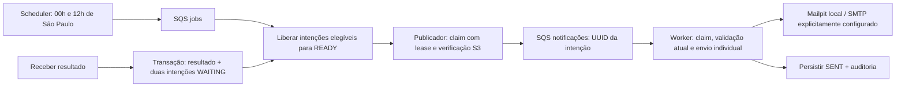

# Avisos de resultados de exames

## Escopo e condição de disponibilidade

O recebimento de resultado pela API registra, na mesma transação, duas intenções de notificação: paciente e médico do atendimento de origem. A outbox usa o UUID imutável do resultado e o tipo de destinatário como chave de deduplicação. Não há backfill automático de resultados anteriores à migração. No modelo atual cada pedido possui um resultado; versões futuras deverão ter UUID próprio.

Um aviso só pode seguir quando o pedido estiver em `RESULT_RECEIVED` ou `REVIEWED`, o destinatário estiver ativo com e-mail válido e o objeto indicado por `storage_key` existir no bucket S3 configurado. O recebimento não passa a significar revisão médica. O worker não baixa conteúdo de exames.

## Fluxo

## Regras de operação

- API e worker pertencem ao mesmo monólito e usam a mesma imagem. A API não consome filas por padrão. Iniciar o worker só após a API saudável evita concorrência no runner de migrations atual.
- Intenções aguardam o job de 12 horas; o publicador apenas drena intenções liberadas. Falhas de arquivo, contato ou destinatário inativo ficam bloqueadas e são reavaliadas no próximo job.
- Claims no PostgreSQL usam `FOR UPDATE SKIP LOCKED`, lease e token. Publicação e envio não mantêm transação aberta durante chamadas de rede. Leases expirados e mensagens perdidas podem ser recuperados pelo próximo job.
- Cada mensagem contém versão de contrato, tipo e UUID da intenção; nunca e-mail, nome, diagnóstico ou chave S3. O job contém somente `CHECK_READY_EXAMS` e versão 1.
- O worker verifica novamente estado, contato e objeto antes de enviar. Sucesso ou duplicata já finalizada confirma a mensagem; falha SMTP transitória mantém a mensagem para nova tentativa. Até cinco tentativas de envio por intenção, depois `FAILED` e DLQ. Falhas de publicação permanecem recuperáveis pelo próximo ciclo.
- Ausência de e-mail não impede o outro destinatário. Cancelamento ou inativação impede novos envios. E-mail alterado é resolvido no momento do envio, sem guardar uma cópia antiga na fila.
- A notificação ao paciente indica os canais habituais da clínica: o projeto ainda não possui portal autenticado de pacientes. O médico recebe o endereço geral do sistema autenticado. Nenhum e-mail contém resultado, nome do exame ou anexo.
- SMTP tem limites de conexão, leitura e escrita. Envio externo fica desabilitado por padrão; captura local aceita apenas Mailpit/loopback. Produção exige habilitação explícita e SMTP/TLS/credenciais próprios.
- `SENT` significa aceitação pelo SMTP, não entrega ou leitura pelo destinatário. Uma falha entre aceitação SMTP e confirmação no banco pode causar duplicidade; SMTP não oferece transação distribuída. Message-ID determinístico facilita rastreabilidade, mas não garante deduplicação do provedor.
- Logs registram somente códigos técnicos e contadores, sem payload, endereço, token, chave de storage ou exceção que possa conter dados pessoais. Sucesso gera auditoria persistente com ID da intenção e ator técnico.

## Validação necessária

Testes de concorrência/lease e SQL em PostgreSQL isolado; testes unitários de duplicatas, falha SMTP e estados bloqueados; teste integrado LocalStack S3/SQS + Mailpit com pacientes/médicos sintéticos. Verificar duas mensagens, reentrega sem novos e-mails e ausência de aviso antes do job, com arquivo ausente ou destinatário inválido. Nenhum teste usa SMTP externo.

Execução local em 28/10/2026: suíte Java 25 com 83 testes, 81 aprovados e dois testes de relatórios ignorados por falta da configuração/carga específica; nenhuma falha. O teste do fluxo completo foi repetido após as verificações finais de destinatário e configuração SMTP. Quatro cenários Terraform simulados, arquitetura backend/frontend e testes do bootstrap também passaram. Oito containers ficaram em execução; login e consulta autenticada passaram após a atualização. O banco PostgreSQL isolado foi removido ao terminar; os e-mails sintéticos permanecem no Mailpit. Não houve envio externo nem implantação AWS.
