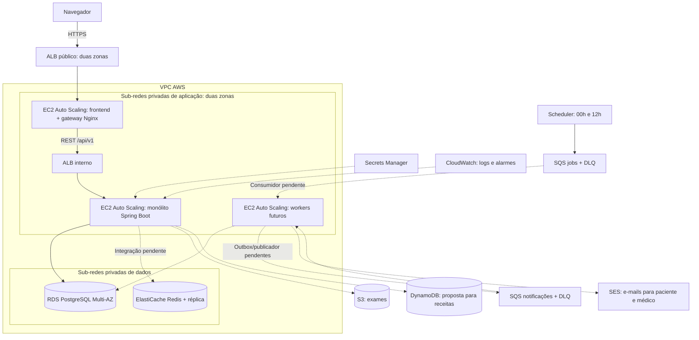

# Alocação da infraestrutura — Clínica Hans

Dois destinos: containers locais para executar a aplicação com serviços AWS emulados; Terraform para alocar a topologia AWS real. Os arquivos não foram aplicados em uma conta AWS.

## Mapa de alocação

| Elemento | Ambiente local | AWS |
|---|---|---|
| Frontend HTML/CSS/JS | Container Nginx, porta 8090 | EC2 privadas em ASG, 2 a 4 instâncias |
| Gateway | Nginx do frontend, proxy `/api/`, limite por IP | Mesmo Nginx nas EC2 web; TLS no ALB público |
| Balanceamento externo | Porta local do frontend | ALB público em duas zonas, HTTPS e redirecionamento HTTP |
| Balanceamento da API | Nginx `backend-lb` | ALB interno em duas zonas |
| Backend Spring Boot | Container Java 25 | EC2 privadas em ASG; inicialmente 0, depois 1 para inicialização e 2 a 6 para escala |
| Workers | Implementação pendente | Launch template e ASG reservados, 0 instâncias até existir consumidor |
| Redis | Container com 256 MB, cache descartável | ElastiCache Redis, primário e réplica, TLS e failover |
| PostgreSQL | Container PostgreSQL 16 e volume existente | RDS PostgreSQL 16 Multi-AZ, armazenamento criptografado e backup |
| Receitas NoSQL | DynamoDB no LocalStack | DynamoDB sob demanda, PITR e proteção contra exclusão |
| Exames | S3 no LocalStack | S3 privado, versionado e criptografado |
| Mensageria | SQS + duas DLQs no LocalStack | SQS de jobs e notificações, DLQ para cada fila |
| Job a cada 12h | Scheduler no LocalStack | EventBridge Scheduler às 00h e 12h de São Paulo |
| E-mail | Mailpit captura SMTP; painel na porta 8025 | SES, identidade de domínio opcional e DKIM |
| Segredos | `.env.localstack`, fora do Git | Secrets Manager, acesso por IAM role das EC2 |
| Logs e alertas | Docker logs e logs Spring | CloudWatch por grupo e alarmes de DLQ |
| Rede e administração | Rede Compose, portas de apoio internas | VPC em duas zonas, sub-redes públicas/app/dados, NAT por zona e SSM; sem SSH público |
| Imagens | Build Docker local | ECR para frontend, backend e futuro worker |



Linhas pontilhadas indicam integrações que a infraestrutura prepara, mas o código atual ainda não implementa. Redis atua ao lado da aplicação; as requisições HTTP não passam pela fila. EC2 é capacidade computacional real na AWS; localmente containers executam a aplicação, sem fingir que instâncias EC2 emuladas executariam seus servidores.

## Subir tudo localmente

Requisitos e ativação: [guia LocalStack](localstack/README.md). Na raiz:

```powershell
Copy-Item .env.localstack.example .env.localstack
# Edite o arquivo: token LocalStack, JWT_SECRET de pelo menos 32 caracteres
# e senha inicial do administrador. Preserve a senha do PostgreSQL existente.
.\scripts\localstack.ps1 start-all
.\scripts\localstack.ps1 verify
```

Aplicação: `http://localhost:8090/login/login.html`. E-mails capturados pelo Mailpit: `http://localhost:8025` (ficará vazio até implementar o worker). Banco usa a porta já configurada no Compose original; nenhum volume existente é removido. `stop-all` para os containers sem apagar volumes. LocalStack pode ser usado sozinho com `start`.

Frontend e backend são construídos dos fontes atuais. A imagem web configura a API na mesma origem; não altera `frontend/config.js` no repositório. Somente o gateway publica a aplicação; o backend fica na rede interna. Perfil de demonstração desabilitado. JWT e permissões continuam validados pelo Spring; o Nginx limita requisições e encaminha a API.

Execute a primeira inicialização com um backend. Depois de verificar migrations e bootstrap, a alocação local pode crescer com `docker compose --env-file .env.localstack -f docker-compose.yml -f docker-compose.localstack.yml -f docker-compose.application.yml up -d --scale backend=2`. Em atualizações com migrations novas, retornar a uma instância antes de atualizar. O runner atual não possui lock distribuído. Aumentar réplicas requer também verificar tarefas agendadas e orçamento total de conexões.

## Preparar AWS sem criar recursos

Requisitos: Terraform >= 1.9, credenciais AWS apropriadas para o ambiente, domínio e certificado ACM regional validado. O Terraform não usa LocalStack; este diretório aponta para AWS real.

```powershell
Copy-Item infra/aws/terraform.tfvars.example infra/aws/terraform.tfvars
# Ajuste ARNs, domínio, região e referências das imagens.
terraform -chdir=infra/aws init
terraform -chdir=infra/aws fmt -check
terraform -chdir=infra/aws validate
terraform -chdir=infra/aws plan -out=allocation.tfplan
```

O `plan` consulta AWS e produz a proposta concreta de alocação; não cria recursos. Aplicar o plano cria recursos pagos, incluindo dois NAT Gateways, dois ALBs, EC2, RDS Multi-AZ e ElastiCache. Nenhum `apply` foi executado por esta entrega.

### Sequência de implantação

1. Criar previamente no Secrets Manager um secret JSON com `JWT_SECRET` (32+ caracteres), `DB_USER`, `DB_PASSWORD` e, no primeiro acesso, `BOOTSTRAP_ADMIN_USERNAME`/`BOOTSTRAP_ADMIN_PASSWORD`. Informar apenas seu ARN ao Terraform. Não versionar valores nem passá-los por user-data ou tfvars.
2. Revisar/aplicar a infraestrutura com `api_desired_capacity=0` e `worker_desired_capacity=0`. As EC2 web poderão repetir a inicialização até as imagens ECR serem publicadas. O estado Terraform precisa de armazenamento remoto criptografado e locking do time antes de uso compartilhado; o exemplo começa com estado local ignorado pelo Git.
3. Usar os outputs para autenticar no ECR, construir e publicar imagens imutáveis. Backend: `docker build -t <backend-image> backend`. Frontend: `docker build -f infra/containers/frontend.Dockerfile -t <frontend-image> .`. O código atual não possui imagem worker funcional.
4. Preparar no RDS o usuário de aplicação compatível com as credenciais do secret, por uma sessão administrativa SSM com acesso ao SG da API. O secret mestre gerenciado do RDS é separado, e a role da aplicação não tem permissão para lê-lo. O usuário que executa migrations precisa de propriedade/permissões de DDL no schema; em produção separar executor de migrations do usuário de operação quando o backend suportar esse fluxo.
5. Definir `api_desired_capacity=1`, revisar/aplicar a atualização e aguardar migrations, bootstrap e readiness do target no ALB interno. Só então ampliar para 2 ou mais; a política de CPU é habilitada quando a capacidade informada excede 1. Durante nova migration, manter uma instância até concluir ou implementar locking antes de rollout concorrente.
6. Criar DNS alias/CNAME do hostname público para o ALB externo. O certificado precisa cobrir esse nome. Sessões administrativas usam SSM, sem chave SSH. Verificar login, autorização, agendamento e acesso ao prontuário antes de liberar usuários.
7. Implementar consumidores de jobs, outbox e e-mails, publicar imagem worker e só então elevar `worker_desired_capacity`. Ajustar a quantidade dos workers por idade/backlog da fila após medir duração de tarefas; esta entrega não inventa uma taxa de consumo.
8. Para SES, informar `email_domain`, publicar TXT de verificação e três CNAME DKIM retornados e verificar sandbox/região/limites antes de envio real. O Terraform não envia e-mails nem solicita saída do sandbox. Alarmes DLQ existem no CloudWatch; configurar o destino de atendimento do time antes da produção.

EC2 usam Amazon Linux 2023, discos criptografados, IMDSv2 obrigatório e roles de instância, sem access keys estáticas. O secret é lido a cada início do serviço e gravado em `/run` com permissão 600; rotação exige reiniciar/renovar instâncias. O tráfego externo é HTTPS; comunicação HTTP entre balanceadores e containers fica na rede privada com security groups restritos. Para exigência de TLS também nesses saltos, adicionar certificados internos e listeners/targets HTTPS antes da produção.

## Limites da entrega

Validação automatizada sem conta AWS: `terraform -chdir=infra/aws test` usa provider simulado para conferir isolamento, proteção do banco, horário do job, escala da API e bloqueio de worker sem imagem. `python -m unittest discover -s infra/localstack/tests -v` verifica reaplicação do bootstrap e propagação de erro de permissão. Esses testes não substituem execução real do emulador.

- Redis foi alocado, mas cache, invalidação e rate limiting distribuído ainda precisam de integração. O limite Nginx é por instância; não usa Redis.
- S3 e DynamoDB estão provisionados, mas o backend ainda não os consome. Prescrições e itens existentes continuam no PostgreSQL; a fonte oficial e o modelo NoSQL precisam ser definidos antes da migração. Downloads/uploads assinados precisam de autorização e CORS do bucket conforme o portal.
- As partições PostgreSQL são criadas pelas migrations existentes e pela manutenção do backend, não pelo Terraform.
- O cron coloca um comando na fila; os e-mails ao paciente/médico e a consulta de exames prontos ainda dependem da implementação do monólito/worker.
- A réplica RDS Multi-AZ é para disponibilidade, não leitura. O particionamento semanal não distribui escrita entre servidores. A configuração inicial é uma base, sem comprovação de capacidade para o volume alvo.
- Falta validar build/execução Docker, restauração, teste de carga, permissões SQL/IAM e entrega agendada em ambiente executável. Alertas de filas não substituem monitoramento completo de latência, banco e disponibilidade.

Referências: [LocalStack](https://docs.localstack.cloud/aws/getting-started/installation/), [Nginx proxy](https://nginx.org/en/docs/http/ngx_http_proxy_module.html), [provider AWS Terraform](https://registry.terraform.io/providers/hashicorp/aws/latest/docs).
