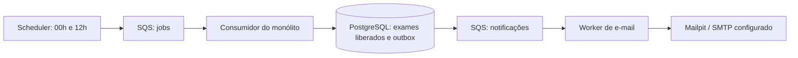

# LocalStack da Clínica Hans

Ambiente local para S3, SQS, DynamoDB e EventBridge Scheduler. O Compose complementar preserva o PostgreSQL existente e não inicia nem modifica o backend.

IAM e STS também ficam habilitados: o Scheduler assume uma role via STS para entregar mensagens na fila. Criar um agendamento com sucesso não comprova essa entrega; o smoke executa um agendamento isolado para conferir o caminho completo.

Para frontend, backend, Redis, balanceador e alocação EC2/AWS, consulte o [mapa completo da infraestrutura](../README.md).

## Executar no Windows

Requisitos: Docker Desktop em modo Linux, Compose v2 e token de ativação LocalStack com acesso aos serviços usados. A versão padrão é `2026.10.0`; pode ser substituída por `LOCALSTACK_VERSION`.

Na raiz do repositório:

```powershell
Copy-Item .env.localstack.example .env.localstack
# Edite .env.localstack e preencha LOCALSTACK_AUTH_TOKEN.
.\scripts\localstack.ps1 start
.\scripts\localstack.ps1 verify
```

O script também aceita `status`, `logs`, `stop` e `provision`. `stop` preserva o volume; `provision` reaplica a configuração sem remover dados. Não execute `docker compose down -v` no projeto para reiniciar apenas o emulador: isso também pode remover o volume PostgreSQL.

Alternativa usando diretamente Docker Compose:

```powershell
docker compose --env-file .env.localstack -f docker-compose.yml -f docker-compose.localstack.yml up -d --wait --wait-timeout 240 localstack
```

O hook Python em `ready.d` cria os recursos automaticamente e pode executar novamente sem recriar dados. A saúde do container depende do sucesso do hook, não apenas da abertura da porta. Não é necessário instalar AWS CLI/Python no host nem montar o socket do Docker.

## Recursos

| Recurso | Nome / configuração |
|---|---|
| S3 | `clinicahans-exames-local`, bloqueio de acesso público, versões e criptografia AES256 |
| DynamoDB | `clinicahans-receitas-local`, chaves string `pk` e `sk`, capacidade sob demanda |
| SQS de jobs | `clinicahans-jobs` e `clinicahans-jobs-dlq` |
| SQS de e-mails | `clinicahans-notificacoes` e `clinicahans-notificacoes-dlq` |
| Scheduler | `clinicahans-exames-prontos-12h`, `cron(0 0,12 * * ? *)`, `America/Sao_Paulo` |

As filas principais usam long polling de 20 segundos, visibilidade de 300 segundos, retenção de 4 dias e DLQ após 5 recebimentos sem sucesso. DLQs retêm mensagens por 14 dias. Workers deverão renovar visibilidade para tarefas longas e excluir mensagens somente após sucesso.

Endpoints: `http://localhost:4566` no host e `http://localstack:4566` em containers na mesma rede Compose. Região: `us-east-1`; credenciais AWS locais: `test` / `test`; conta padrão: `000000000000`. Para S3, configurar path-style no cliente. Essas variáveis ainda não são consumidas pelo backend atual. O endpoint público para URLs assinadas precisa ser acessível pelo navegador; não entregar URLs com hostname interno `localstack`.

Use somente dados sintéticos. O emulador não comprova segurança, durabilidade, desempenho ou capacidade de produção. O bucket não tem expiração automática de exames. A tabela NoSQL é uma preparação experimental; prescrições existentes continuam no PostgreSQL, sem migração ou escrita dupla. O modelo de acesso e o versionamento de receitas ainda precisam de especificação antes da integração clínica.

## Avisos de exames a cada 12 horas



O agendamento envia apenas `{"type":"CHECK_READY_EXAMS","schemaVersion":1}` à fila de jobs. Não contém pacientes, resultados ou endereços de e-mail. Falhas de entrega do Scheduler vão para a DLQ de jobs, com até 3 tentativas e idade máxima de 1 hora.

O worker do monólito implementa consumo do job, outbox transacional e envio individual, habilitado localmente por `start-all`. O script de provisionamento não envia e-mails: ele configura os recursos. Os avisos de resultados novos só seguem após o job e a verificação de existência do arquivo no S3. Captura local pelo Mailpit; nenhuma mensagem contém resultado ou anexo. Como o portal de pacientes ainda não existe, a mensagem ao paciente orienta os canais da clínica, enquanto a do médico aponta ao sistema autenticado. Atraso esperado: até 12 horas mais fila/retries. [Regras, deduplicação e limites SMTP](../../docs/specs/exam-ready-notifications.md).

## Verificação

`verify` confere configuração das filas/DLQs, proteção do bucket, tabela e horário do Scheduler. Também faz round-trip com conteúdo sintético em fila temporária, objeto versionado e item isolado, além de testar a entrega de um agendamento temporário em SQS (espera de até 60 segundos). Remove os recursos sintéticos ao terminar. Não consome jobs/notificações reais nem envia e-mails. Usa o Python do ambiente virtual interno do LocalStack, que contém boto3. Reaplique `provision` e execute `verify` para conferir o provisionamento repetido.

Referências oficiais: [instalação e token](https://docs.localstack.cloud/aws/getting-started/installation/), [hooks de inicialização](https://docs.localstack.cloud/aws/customization/advanced/initialization-hooks/) e [Scheduler com destino SQS](https://docs.localstack.cloud/aws/services/scheduler/).
